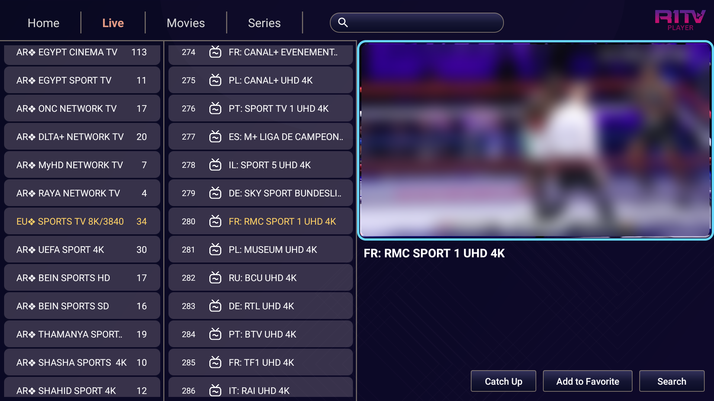
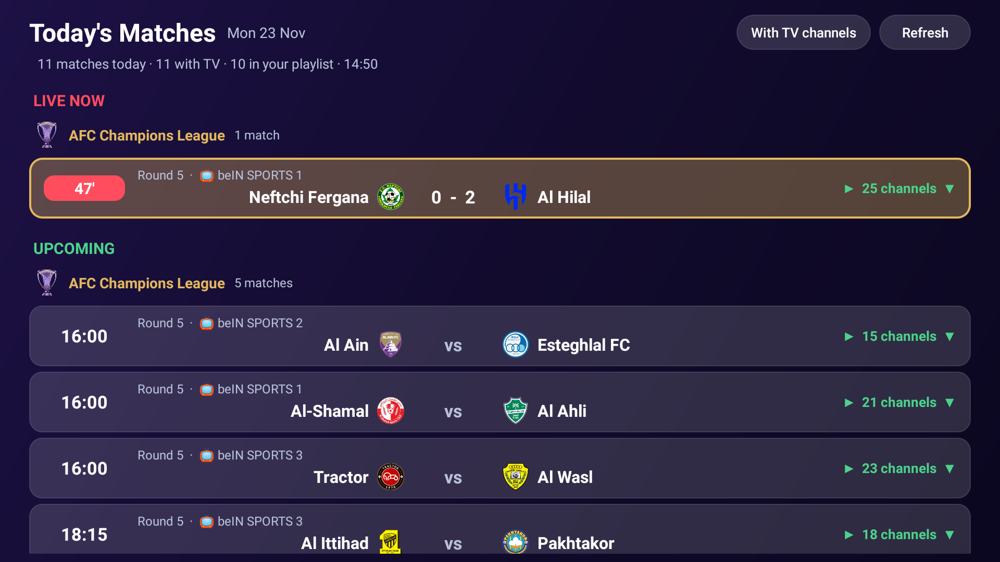
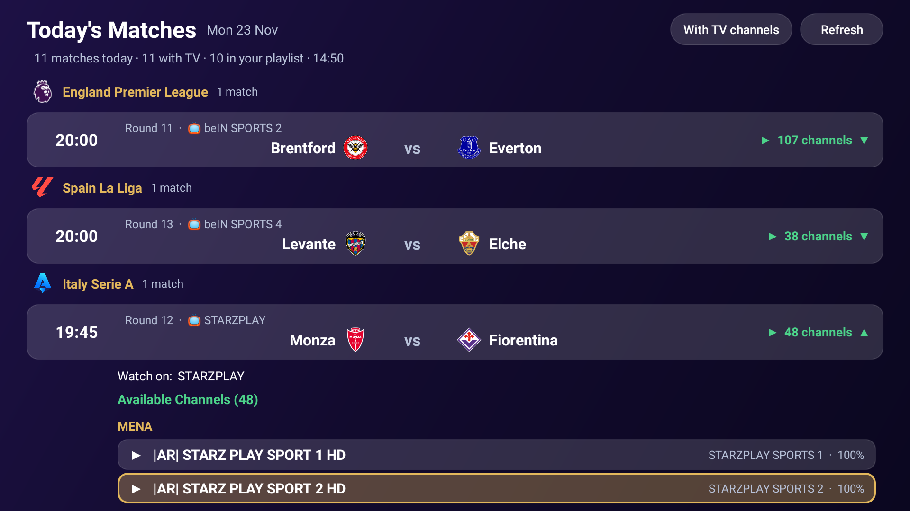
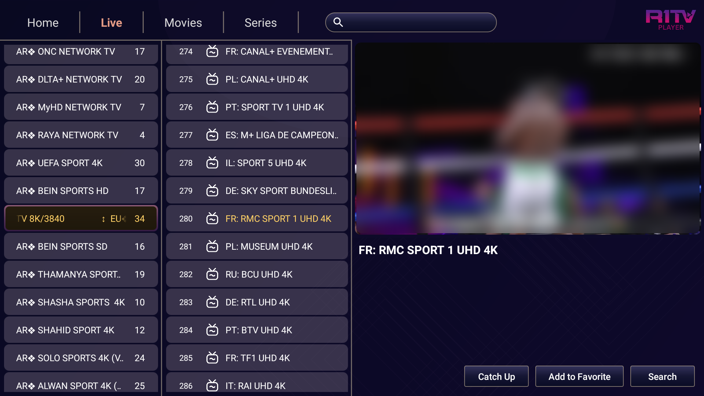
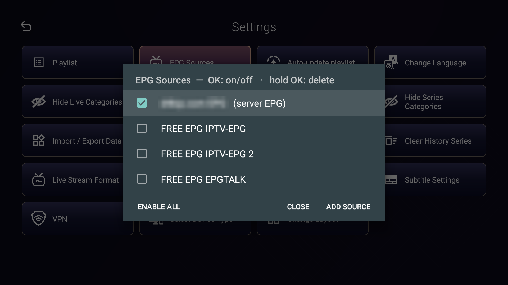

# R1TV Player

**مشغّل IPTV لنظام Android مع واجهة مهيّأة للتلفاز والهاتف.**  
**An Android IPTV player with an interface designed for TVs and phones.**

## ⬇ Download / التنزيل

**[R1TV-Player.apk — latest version / آخر إصدار](https://github.com/r1tec-store/R1TV-Player/releases/latest/download/R1TV-Player.apk)**

### 📺 Downloader code: `2795393`

On Android TV / Google TV / Fire TV: open the **Downloader** app, type **2795393** and press **Go** — it downloads the latest R1TV-Player.apk, then press **Install**. (Short link: [aftv.news/2795393](https://aftv.news/2795393))

على Android TV أو Google TV أو Fire TV: افتح تطبيق **Downloader**، اكتب الرمز **2795393** ثم اضغط **Go** — يتم تنزيل آخر إصدار من R1TV-Player.apk، ثم اضغط **Install**. (رابط مختصر: [aftv.news/2795393](https://aftv.news/2795393))

Permanent link (always the newest version) / رابط دائم (دائما آخر إصدار):  
`https://github.com/r1tec-store/R1TV-Player/releases/latest/download/R1TV-Player.apk`

Version number, changes and SHA-256 checksum: see the [latest release](https://github.com/r1tec-store/R1TV-Player/releases/latest). — رقم الإصدار والتغييرات وبصمة SHA-256 في صفحة [آخر إصدار](https://github.com/r1tec-store/R1TV-Player/releases/latest).

## Screenshots / لقطات الشاشة

| Home / الرئيسية | Live TV / البث المباشر |
|---|---|
|  |  |

| Today's Matches / مباريات اليوم | Match channels / قنوات المباراة |
|---|---|
|  |  |

| Group order / ترتيب المجموعات | EPG sources / مصادر دليل البرامج |
|---|---|
|  |  |

| Settings / الإعدادات | Playlist form / إضافة قائمة |
|---|---|
|  |  |

| Playlist status / حالة القائمة | Phone icon / أيقونة الهاتف |
|---|---|
|  |  |

## Features / المميزات

The full list is in [FEATURES.md](FEATURES.md). / القائمة الكاملة في [FEATURES.md](FEATURES.md).

### English

- **Playlists** — add an **M3U URL** or **Xtream Codes** login, name it, manage several playlists, see connection status, reload.
- **Auto-update** — the playlist refreshes every 6, 12 (default), 24 or 48 hours; the EPG is refreshed with it.
- **Today's Matches** — today's football matches from **Fixtures OnSAT** (our own match service), in the same order as the website: live minute and score, kick-off times, rounds, team and competition logos, the main broadcaster and the commentator. Every TV channel of a match is searched in **your own playlist** by **name and country** (the channel prefix or its group: `|AR|`, `ARAB| EGYPT`, `AF| AZAM`, `ASIA| IRAN`, `EU| ROMANIA` …; HD/FHD/4K ignored). Only sure channels are shown; OK on a channel plays it fullscreen. Channels that are not in your playlist are listed separately and are never shown as playable.
- **Match channels** — grouped by country; STARZPLAY matches open STARZPLAY SPORTS 1 and 2; Egyptian League matches find ON Sport (ONTIME SPORTS); beIN SPORTS English stays separate from the Arabic beIN. Matches are shown live first, then upcoming, then finished; channels of a finished match disappear 15 minutes after the end (the result stays).
- **Full translation** — the whole app follows the language chosen in Settings (English, Arabic, French, Spanish, Italian), including Today's Matches, all dialogs and messages.
- **Updates from GitHub** — Settings → **Check for updates** compares the app with the latest release, shows what is new, downloads the APK from the permanent link and opens the Android installer. The app also checks quietly every 3 hours; a required update cannot be postponed.
- **First-use tips** — a short tip (English + Arabic) appears once in Live (how to reorder groups) and once in Today's Matches (how to open and play a match's channels).
- **Live TV** — groups, channels and a live preview with rounded corners and a rounded focus frame; OK = fullscreen.
- **Fullscreen channel list** — DOWN shows the group's channels over the video; LEFT / RIGHT switch groups; OK plays.
- **Group order** — hold OK on a group in Live, Movies or Series, move it with ▲ ▼ (the list follows it past the screen), OK saves instantly, BACK cancels. On phones: press and hold, then drag the group. Hold OK on a fixed row to reset to the provider's order.
- **EPG (TV guide)** — provider EPG on by default; optional free XMLTV sources and your own `.xml` / `.xml.gz` links, with smart channel matching by name and country.
- **Movies & Series** — browse by group, sort, search, resume watching, favorites, catch-up where the provider supports it.
- **Import / Export** — one-click backup to the Download folder; restore from any file-manager app.
- **TV remote first** — full D-pad navigation; double BACK on the home screen exits, the EXIT tile closes the app directly.
- **Phones too** — touch layouts, fullscreen player that keeps playing after the notification shade, adaptive launcher icon.
- **Languages** — Arabic, French, English, Spanish and Italian. VPN controls in Settings.

Match data and broadcaster names come from Fixtures OnSAT. Channels named by the service are never shown as playable: only channels of your own playlist can be played.

The app is a player. This repository does not provide IPTV subscriptions, channels, movies, series, playlist URLs, or login credentials. Add only playlists and services you are authorized to use.

### العربية

- **القوائم** — إضافة **رابط M3U** أو **بيانات Xtream Codes** مع تسمية القائمة، وإدارة عدة قوائم ومعرفة حالة الاتصال وإعادة التحميل.
- **التحديث التلقائي** — تحديث القائمة كل 6 أو 12 (افتراضي) أو 24 أو 48 ساعة، مع تحديث دليل البرامج معها.
- **مباريات اليوم** — مباريات كرة القدم لليوم من **Fixtures OnSAT** (خدمة المباريات الخاصة بنا) بنفس ترتيب الموقع: الدقيقة والنتيجة المباشرة وموعد الانطلاق والجولة وشعارات الفرق والبطولات والقناة الناقلة والمعلق. كل قناة ناقلة يُبحث عنها في **قائمتك أنت** حسب **الاسم والبلد** (بادئة القناة أو مجموعتها: `|AR|` و `ARAB| EGYPT` و `AF| AZAM` و `ASIA| IRAN` و `EU| ROMANIA` …، مع تجاهل HD/FHD/4K). تظهر القنوات المؤكدة فقط، وزر OK على القناة يشغّلها بالشاشة الكاملة. القنوات غير الموجودة في قائمتك تظهر في قسم منفصل ولا تُعرض كقنوات قابلة للتشغيل.
- **قنوات المباراة** — مجمّعة حسب البلد؛ مباريات STARZPLAY تفتح STARZPLAY SPORTS 1 و 2، ومباريات الدوري المصري تجد ON Sport (ONTIME SPORTS)، و beIN SPORTS English منفصلة عن beIN العربية. المباريات تظهر: المباشرة أولا ثم القادمة ثم المنتهية، وقنوات المباراة المنتهية تختفي بعد 15 دقيقة من نهايتها وتبقى النتيجة.
- **ترجمة كاملة** — التطبيق كله يتبع اللغة المختارة في الإعدادات (العربية، الإنجليزية، الفرنسية، الإسبانية، الإيطالية)، بما في ذلك مباريات اليوم وكل النوافذ والرسائل.
- **التحديث من GitHub** — الإعدادات ← **التحقق من التحديثات** يقارن التطبيق بآخر إصدار، ويعرض الجديد، وينزّل ملف APK من الرابط الدائم ويفتح أداة التثبيت. ويتحقق التطبيق تلقائيا كل 3 ساعات، والتحديث الإلزامي لا يمكن تأجيله.
- **نصائح أول استعمال** — نافذة قصيرة (بالعربية والإنجليزية) تظهر مرة واحدة في البث المباشر (كيفية ترتيب المجموعات) ومرة في مباريات اليوم (كيفية فتح قنوات المباراة وتشغيلها).
- **البث المباشر** — المجموعات والقنوات ومعاينة مباشرة بزوايا دائرية وإطار تركيز دائري؛ زر OK للشاشة الكاملة.
- **قائمة القنوات في الشاشة الكاملة** — زر الأسفل يعرض قنوات المجموعة فوق الفيديو، ويمين / يسار للتنقل بين المجموعات، وOK للتشغيل.
- **ترتيب المجموعات** — اضغط مطولا على OK فوق مجموعة في المباشر أو الأفلام أو المسلسلات، وحرّكها بـ ▲ ▼ (القائمة تتبعها حتى خارج الشاشة)، وOK يحفظ فورا وBACK يلغي. على الهاتف: اضغط مطولا ثم اسحب المجموعة. الضغط المطوّل على صف ثابت يعيد ترتيب المزوّد الأصلي.
- **دليل البرامج EPG** — دليل المزوّد مفعّل افتراضيا، مع مصادر XMLTV مجانية اختيارية وإمكانية إضافة روابط `.xml` أو `.xml.gz` خاصة، ومطابقة ذكية للقنوات حسب الاسم والدولة.
- **الأفلام والمسلسلات** — تصفح حسب المجموعة والترتيب والبحث ومتابعة المشاهدة والمفضلة والإعادة (Catch-up) عند توفرها من المزوّد.
- **الاستيراد والتصدير** — نسخة احتياطية بضغطة واحدة إلى مجلد Download والاستعادة من أي تطبيق لإدارة الملفات.
- **مصمم لجهاز التحكم** — تنقل كامل بالأسهم؛ الضغط مرتين على BACK في الرئيسية للخروج، وزر EXIT يغلق التطبيق مباشرة.
- **للهاتف أيضا** — واجهات لمس، ومشغل بشاشة كاملة يواصل العمل بعد إنزال الإشعارات، وأيقونة تطبيق متكيفة.
- **اللغات** — العربية والفرنسية والإنجليزية والإسبانية والإيطالية. أدوات VPN ضمن الإعدادات.

التطبيق مشغّل فقط. لا يوفر هذا المستودع اشتراكات IPTV أو قنوات أو أفلاما أو مسلسلات أو روابط قوائم أو بيانات دخول. أضف فقط القوائم والخدمات التي تملك حق استخدامها.

## App details / معلومات التطبيق

| | |
|---|---|
| App name / اسم التطبيق | R1TV Player |
| Version / الإصدار | see the [latest release](https://github.com/r1tec-store/R1TV-Player/releases/latest) / انظر [آخر إصدار](https://github.com/r1tec-store/R1TV-Player/releases/latest) |
| Android package / معرّف الحزمة | `com.r1tv.player2` |
| Minimum Android / الحد الأدنى لأندرويد | Android 5.0, API 21 |
| Target SDK / إصدار الاستهداف | API 34 |
| Test device / جهاز الاختبار | Android TV (Android 11) |

## Download and install / التنزيل والتثبيت

Download [`R1TV-Player.apk`](https://github.com/r1tec-store/R1TV-Player/releases/latest/download/R1TV-Player.apk) (always the latest version) and install it on an Android device or Android TV. It installs over an existing copy — playlists and settings are kept. Android may ask you to allow installation from the app used to open the APK. Review the requested permissions before accepting.

نزّل [`R1TV-Player.apk`](https://github.com/r1tec-store/R1TV-Player/releases/latest/download/R1TV-Player.apk) (دائما آخر إصدار) وثبّته على جهاز Android أو Android TV. يتم التحديث فوق الإصدار المثبّت مع الاحتفاظ بالقوائم والإعدادات. قد يطلب Android السماح بالتثبيت من التطبيق الذي فتح ملف APK؛ راجع الأذونات المطلوبة قبل الموافقة.

## Backups and privacy / النسخ الاحتياطي والخصوصية

Backup files can contain playlist URLs, Xtream usernames and passwords, and app settings. Keep backup files private and do not commit them to GitHub. Never publish real account credentials, private server addresses, device keys, or personal screenshots.

قد تحتوي ملفات النسخ الاحتياطي على روابط القوائم وأسماء المستخدمين وكلمات المرور وإعدادات التطبيق. احتفظ بها بشكل خاص ولا ترفعها إلى GitHub. لا تنشر بيانات دخول حقيقية أو عناوين خوادم خاصة أو مفاتيح الأجهزة أو صورا شخصية.

## License and redistribution / الترخيص وإعادة التوزيع

No open-source license is granted by this repository. Confirm that you have permission to redistribute the APK and all included third-party components and assets. Details are in [NOTICE.md](NOTICE.md).
