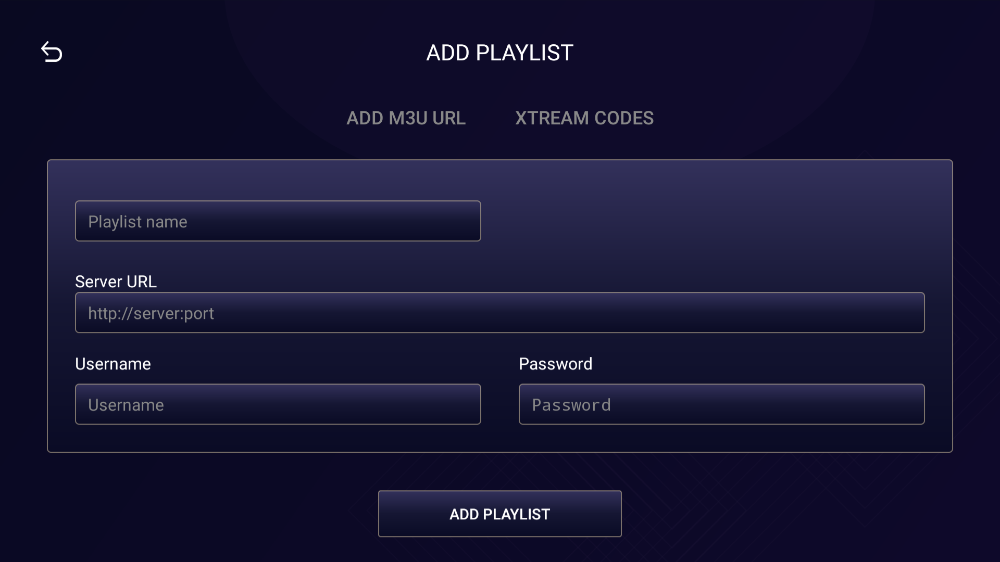
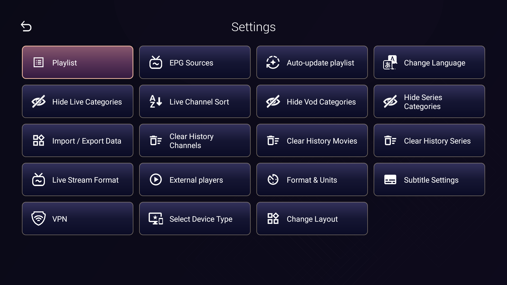

# R1TV Player

**مشغّل IPTV لنظام Android مع واجهة مهيّأة للتلفاز والهاتف.**  
**An Android IPTV player with an interface designed for TVs and phones.**

> This repository package contains the v1.0.0 APK and documentation. It does not include the original editable source project. See [NOTICE.md](NOTICE.md) before publishing or redistributing the APK.

## Screenshots / لقطات الشاشة

| Home / الرئيسية | Playlist form / إضافة قائمة |
|---|---|
|  |  |

| Playlist status / حالة القائمة | Settings / الإعدادات |
|---|---|
|  |  |

## Features / المميزات

### English

- First launch opens the playlist setup form directly.
- Add playlists using an **M3U URL** or **Xtream Codes** credentials; assign a playlist name.
- Manage saved playlists, see their connection status, connect or disconnect, and refresh them.
- Browse Live TV, Movies, and Series supplied by the playlist you add.
- Search across the available items in the current media section.
- Choose automatic playlist refresh every 6 hours, 12 hours (default), 24 hours, or 48 hours.
- Import and export app settings and playlist data using the app's backup feature.
- TV remote navigation with visible focus styling; the live preview can receive focus.
- Arabic, French, English, Spanish, and Italian interface options.
- VPN controls are available in Settings.

The app is a player. This repository does not provide IPTV subscriptions, channels, movies, series, playlist URLs, or login credentials. Add only playlists and services you are authorized to use.

### العربية

- عند التشغيل الأول، يفتح التطبيق نموذج إضافة القائمة مباشرة.
- إضافة القوائم بواسطة **رابط M3U** أو **بيانات Xtream Codes** مع إمكانية تسمية القائمة.
- إدارة القوائم المحفوظة وعرض حالة الاتصال، مع خيارات الاتصال وقطع الاتصال والتحديث.
- تصفح البث المباشر والأفلام والمسلسلات التي توفرها القائمة التي يضيفها المستخدم.
- البحث في العناصر المتاحة ضمن قسم الوسائط الحالي.
- التحديث التلقائي للقائمة كل 6 ساعات أو 12 ساعة (افتراضي) أو 24 ساعة أو 48 ساعة.
- استيراد وتصدير إعدادات التطبيق وبيانات قوائم التشغيل عبر النسخ الاحتياطي.
- تنقل بجهاز تحكم التلفاز مع إبراز العنصر المحدد، وإمكانية تحديد معاينة البث.
- واجهة بالعربية والفرنسية والإنجليزية والإسبانية والإيطالية.
- أدوات VPN موجودة ضمن الإعدادات.

التطبيق مشغّل فقط. لا يوفر هذا المستودع اشتراكات IPTV أو قنوات أو أفلاما أو مسلسلات أو روابط قوائم أو بيانات دخول. أضف فقط القوائم والخدمات التي تملك حق استخدامها.

## App details / معلومات التطبيق

| | |
|---|---|
| App name / اسم التطبيق | R1TV Player |
| Version / الإصدار | 1.0.0 |
| Android package / معرّف الحزمة | `com.r1tv.player2` |
| Minimum Android / الحد الأدنى لأندرويد | Android 5.0, API 21 |
| Target SDK / إصدار الاستهداف | API 34 |
| Test device / جهاز الاختبار | Android TV; first-run setup and playlist connection checked |

## Download and install / التنزيل والتثبيت

Download `R1TV-Player-v1.0.0.apk` from the repository's **Releases** page and install it on an Android device or Android TV. Android may ask you to allow installation from the app used to open the APK. Review the requested permissions before accepting.

نزّل `R1TV-Player-v1.0.0.apk` من صفحة **Releases** في المستودع وثبّته على جهاز Android أو Android TV. قد يطلب Android السماح بالتثبيت من التطبيق الذي فتح ملف APK؛ راجع الأذونات المطلوبة قبل الموافقة.

## Backups and privacy / النسخ الاحتياطي والخصوصية

Backup files can contain playlist URLs, Xtream usernames and passwords, and app settings. Keep backup files private and do not commit them to GitHub. Never publish real account credentials, private server addresses, device keys, or personal screenshots.

قد تحتوي ملفات النسخ الاحتياطي على روابط القوائم وأسماء المستخدمين وكلمات المرور وإعدادات التطبيق. احتفظ بها بشكل خاص ولا ترفعها إلى GitHub. لا تنشر بيانات دخول حقيقية أو عناوين خوادم خاصة أو مفاتيح الأجهزة أو صورا شخصية.

## License and redistribution / الترخيص وإعادة التوزيع

No open-source license is granted by this repository package. Confirm that you have permission to redistribute the APK and all included third-party components and assets before making the repository public. Details are in [NOTICE.md](NOTICE.md).
