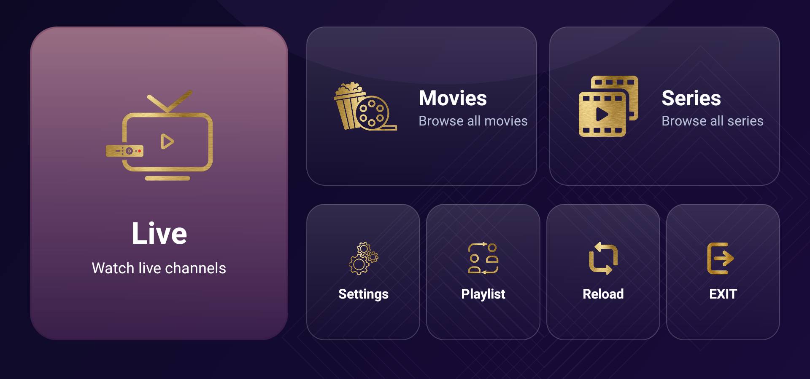
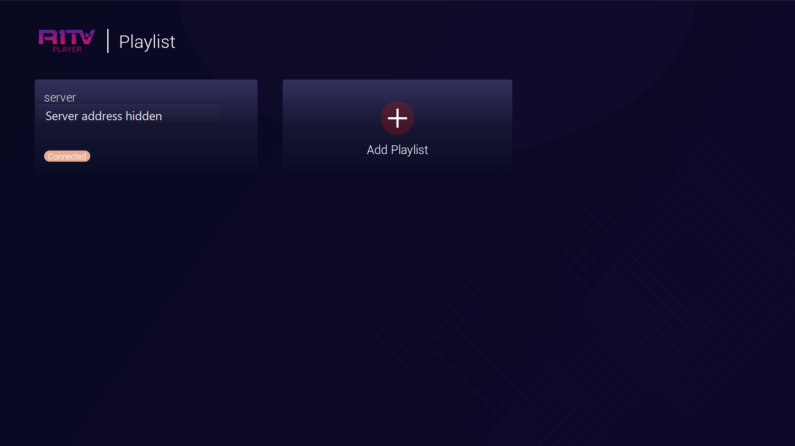

# R1TV Player

**مشغّل IPTV لنظام Android مع واجهة مهيّأة للتلفاز والهاتف.**  
**An Android IPTV player with an interface designed for TVs and phones.**

> Latest version: **v1.4.0** — download the APK from the [Releases](https://github.com/r1tec-store/R1TV-Player/releases/latest) page.  
> آخر إصدار: **v1.4.0** — نزّل ملف APK من صفحة [Releases](https://github.com/r1tec-store/R1TV-Player/releases/latest).

## Screenshots / لقطات الشاشة

| Home / الرئيسية | Live TV / البث المباشر |
|---|---|
|  |  |

| Group order / ترتيب المجموعات | EPG sources / مصادر دليل البرامج |
|---|---|
|  |  |

| Settings / الإعدادات | Playlist form / إضافة قائمة |
|---|---|
|  |  |

| Playlist status / حالة القائمة | Phone icon / أيقونة الهاتف |
|---|---|
|  |  |

## Features / المميزات

The full list is in [FEATURES.md](FEATURES.md). / القائمة الكاملة في [FEATURES.md](FEATURES.md).

### English

- **Playlists** — add an **M3U URL** or **Xtream Codes** login, name it, manage several playlists, see connection status, reload.
- **Auto-update** — the playlist refreshes every 6, 12 (default), 24 or 48 hours; the EPG is refreshed with it.
- **Live TV** — groups, channels and a live preview with rounded corners and a rounded focus frame; OK = fullscreen.
- **Fullscreen channel list** — DOWN shows the group's channels over the video; LEFT / RIGHT switch groups; OK plays.
- **Group order** — hold OK on a group in Live, Movies or Series, move it with ▲ ▼ (the list follows it past the screen), OK saves instantly, BACK cancels. Hold OK on a fixed row to reset to the provider's order.
- **EPG (TV guide)** — provider EPG on by default; optional free XMLTV sources and your own `.xml` / `.xml.gz` links, with smart channel matching by name and country.
- **Movies & Series** — browse by group, sort, search, resume watching, favorites, catch-up where the provider supports it.
- **Import / Export** — one-click backup to the Download folder; restore from any file-manager app.
- **TV remote first** — full D-pad navigation; double BACK on the home screen exits, the EXIT tile closes the app directly.
- **Phones too** — touch layouts, fullscreen player that keeps playing after the notification shade, adaptive launcher icon.
- **Languages** — Arabic, French, English, Spanish and Italian. VPN controls in Settings.

The app is a player. This repository does not provide IPTV subscriptions, channels, movies, series, playlist URLs, or login credentials. Add only playlists and services you are authorized to use.

### العربية

- **القوائم** — إضافة **رابط M3U** أو **بيانات Xtream Codes** مع تسمية القائمة، وإدارة عدة قوائم ومعرفة حالة الاتصال وإعادة التحميل.
- **التحديث التلقائي** — تحديث القائمة كل 6 أو 12 (افتراضي) أو 24 أو 48 ساعة، مع تحديث دليل البرامج معها.
- **البث المباشر** — المجموعات والقنوات ومعاينة مباشرة بزوايا دائرية وإطار تركيز دائري؛ زر OK للشاشة الكاملة.
- **قائمة القنوات في الشاشة الكاملة** — زر الأسفل يعرض قنوات المجموعة فوق الفيديو، ويمين / يسار للتنقل بين المجموعات، وOK للتشغيل.
- **ترتيب المجموعات** — اضغط مطولا على OK فوق مجموعة في المباشر أو الأفلام أو المسلسلات، وحرّكها بـ ▲ ▼ (القائمة تتبعها حتى خارج الشاشة)، وOK يحفظ فورا وBACK يلغي. الضغط المطوّل على صف ثابت يعيد ترتيب المزوّد الأصلي.
- **دليل البرامج EPG** — دليل المزوّد مفعّل افتراضيا، مع مصادر XMLTV مجانية اختيارية وإمكانية إضافة روابط `.xml` أو `.xml.gz` خاصة، ومطابقة ذكية للقنوات حسب الاسم والدولة.
- **الأفلام والمسلسلات** — تصفح حسب المجموعة والترتيب والبحث ومتابعة المشاهدة والمفضلة والإعادة (Catch-up) عند توفرها من المزوّد.
- **الاستيراد والتصدير** — نسخة احتياطية بضغطة واحدة إلى مجلد Download والاستعادة من أي تطبيق لإدارة الملفات.
- **مصمم لجهاز التحكم** — تنقل كامل بالأسهم؛ الضغط مرتين على BACK في الرئيسية للخروج، وزر EXIT يغلق التطبيق مباشرة.
- **للهاتف أيضا** — واجهات لمس، ومشغل بشاشة كاملة يواصل العمل بعد إنزال الإشعارات، وأيقونة تطبيق متكيفة.
- **اللغات** — العربية والفرنسية والإنجليزية والإسبانية والإيطالية. أدوات VPN ضمن الإعدادات.

التطبيق مشغّل فقط. لا يوفر هذا المستودع اشتراكات IPTV أو قنوات أو أفلاما أو مسلسلات أو روابط قوائم أو بيانات دخول. أضف فقط القوائم والخدمات التي تملك حق استخدامها.

## What's new in v1.4.0 / الجديد في الإصدار 1.4.0

- Double BACK to exit; the EXIT tile no longer asks yes / no. — الخروج بالضغط مرتين على BACK، وزر EXIT بدون سؤال نعم / لا.
- EPG defaults: provider EPG on, free EPG sources off. — الإعداد الافتراضي: دليل المزوّد مفعّل والمصادر المجانية معطّلة.
- Moving a group: it stays visible while moving beyond the screen. — المجموعة المنقولة تبقى ظاهرة أثناء التحريك خارج الشاشة.
- No more black screen after saving or cancelling a group move. — لا شاشة سوداء بعد حفظ الترتيب أو إلغائه.
- The white line at the top on some devices is gone; edges match the app background. — إزالة الخط الأبيض العلوي في بعض الأجهزة.
- Phone: fullscreen player no longer turns black after the notification shade or a pop-up. — الهاتف: المشغل لا يتحول للأسود بعد إنزال الإشعارات.
- Rounded live preview and rounded focus frame. — معاينة بزوايا دائرية وإطار تركيز دائري.
- New phone launcher icon. — أيقونة جديدة للتطبيق على الهاتف.

## App details / معلومات التطبيق

| | |
|---|---|
| App name / اسم التطبيق | R1TV Player |
| Version / الإصدار | 1.4.0 (versionCode 14) |
| Android package / معرّف الحزمة | `com.r1tv.player2` |
| Minimum Android / الحد الأدنى لأندرويد | Android 5.0, API 21 |
| Target SDK / إصدار الاستهداف | API 34 |
| Test device / جهاز الاختبار | Android TV (Android 11) |

## Download and install / التنزيل والتثبيت

Download `R1TV-Player-v1.4.0.apk` from the [Releases](https://github.com/r1tec-store/R1TV-Player/releases/latest) page and install it on an Android device or Android TV. It updates an installed v1.x over the top — playlists and settings are kept. Android may ask you to allow installation from the app used to open the APK. Review the requested permissions before accepting.

نزّل `R1TV-Player-v1.4.0.apk` من صفحة [Releases](https://github.com/r1tec-store/R1TV-Player/releases/latest) وثبّته على جهاز Android أو Android TV. يتم التحديث فوق الإصدار المثبّت مع الاحتفاظ بالقوائم والإعدادات. قد يطلب Android السماح بالتثبيت من التطبيق الذي فتح ملف APK؛ راجع الأذونات المطلوبة قبل الموافقة.

## Backups and privacy / النسخ الاحتياطي والخصوصية

Backup files can contain playlist URLs, Xtream usernames and passwords, and app settings. Keep backup files private and do not commit them to GitHub. Never publish real account credentials, private server addresses, device keys, or personal screenshots.

قد تحتوي ملفات النسخ الاحتياطي على روابط القوائم وأسماء المستخدمين وكلمات المرور وإعدادات التطبيق. احتفظ بها بشكل خاص ولا ترفعها إلى GitHub. لا تنشر بيانات دخول حقيقية أو عناوين خوادم خاصة أو مفاتيح الأجهزة أو صورا شخصية.

## License and redistribution / الترخيص وإعادة التوزيع

No open-source license is granted by this repository. Confirm that you have permission to redistribute the APK and all included third-party components and assets. Details are in [NOTICE.md](NOTICE.md).
